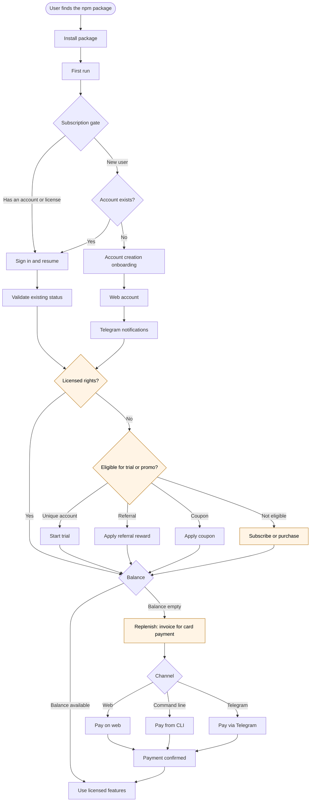

# StakeReloadXS User Journey

**Status: design draft.** This diagram describes the intended flow. No step is implemented yet. Steps marked **[LEGAL GATE]** may not be implemented until counsel clears the entitlement and licensing logic.

## Current state of the storefront

The live storefront (`xs-web`) does not yet follow this journey. Today, a visitor browses the catalog and hands off the order through Telegram or email to complete the sale. The site does not call `POST /api/order`, because `orderEndpoint` is empty, so nothing is stored in D1. No account, balance, trial, or hosted invoice exists on the storefront. The diagram above is the target, not the current behavior.

## Legend

- **Subscription gate (D):** the first-run check that decides whether the user can proceed.
- **Validate existing status (J):** confirms any prior account, license, or balance before anything new is created.
- **Trial, referral, coupon (M to P):** each path needs abuse controls, such as a unique-account check. The rules are `UNKNOWN` and need a product decision.
- **Replenish (S):** an invoice paid with existing card payment details. Raw card numbers are never stored by StakeReloadXS. Payments go through a PCI-compliant processor, which is `UNKNOWN` until selected.
- **Amber nodes** are the legally gated decision points.

## Open decisions

1. Trial eligibility rules and how "unique account" is verified.
2. Referral and coupon reward terms.
3. Which payment processor handles invoices and card-on-file.
4. Whether Telegram is required or optional at onboarding.
5. Pricing and balance units. None are set.
6. Whether a paid subscription purchase exists separately from balance replenishment. The "Subscribe or purchase" node (Q) is a placeholder for an option that has not been specified.
